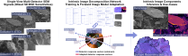

# Adaptive Inverse Rendering and Denoising in Single-View Multi-Detector Scanning Electron Microscopy

**TODO 2026** · [cphoto.fit.vutbr.cz/trinity](https://cphoto.fit.vutbr.cz/trinity/)

Given a triplet of co-registered SEM scans from different detectors, the model decomposes them into surface normals, material contrast, and frequency-specific residuals via predominantly self-supervised adaptation to each sample: without explicit detector calibration.

---

## Setup

```bash
python -m venv .venv
source .venv/bin/activate
pip install -r requirements.txt
```

---

## Inference

Run cross-validated inference over all 7 folds using the `enc4L_ch96_aspp` architecture (the paper baseline):

```bash
python src/run_inference.py
```

Outputs are written to `inferred_latents/enc4L_ch96_aspp_finetune/` by default. Run with `--help` for all options (custom architecture, checkpoint root, fold selection, output directory).

**Viewer:** interactive 3D relief visualization of inferred latents:

```bash
python src/gui/viewer.py --latents_root_dir inferred_latents/enc4L_ch96_aspp_finetune
```

---

## Training from Scratch

Pre-computed tool outputs required by training are in `src/ablation_study/ablation_results/data_cache/`. Run from `src/`:

**Stage 1 - self-supervised pretraining:**
```bash
python pretrain.py \
  --input_data_root ../trinity_sem_dataset \
  --spherical_particles_data_csv_path ablation_study/ablation_results/data_cache/spherical_particles.csv \
  --output_dir <output_dir>
```

**Stage 2 - noise isolation fine-tuning:**
```bash
python finetune.py \
  --input_data_root ../trinity_sem_dataset \
  --intra_sample_registration_data_csv_path ../src/ablation_study/ablation_results/data_cache/registration_shifts.csv \
  --finetune_pretrained_checkpoint_path <pretrain_checkpoint.pth> \
  --output_dir <output_dir>
```

Both scripts accept `--evaluation_specimen_names` (comma-delimited) to set the held-out fold.

---

## Ablation Study

The ablation study covers 36 architecture variants × 7 folds on a PBS cluster. Scripts are in `src/ablation_study/`. Run them in order:

```bash
# 1. Prepare Otsu-thresholded pseudo-ground-truth registration data
qsub src/ablation_study/submit_ablation_data_prep.sh

# 2. Train all 252 runs (36 configs × 7 folds)
qsub src/ablation_study/submit_ablation_train.sh

# 3. Evaluate all runs
qsub src/ablation_study/submit_ablation_evaluate.sh
```

State is tracked in `src/ablation_study/ablation_results/ablation_state.json`. See `src/ablation_study/ABLATION_README.md` for details.

---

## Objective Evaluation

Run from `src/objective_evaluation/` in order. Pre-inferred latents from `python src/run_inference.py` are required for steps 1 and 5.

```bash
# 1. Plot learned detector parameters from inferred latents
python _1_plot_learned_detector_parameters.py \
  --preinferred_latents_root ../../inferred_latents/enc4L_ch96_aspp_finetune

# 2. Synthesize pseudo-ground-truth (Otsu threshold on inlier max-SNR)
python _2_synthesize_pseudo_ground_truth.py \
  --input_data_root ../../trinity_sem_dataset \
  --intra_sample_registration_data_csv_path ../ablation_study/ablation_results/data_cache/registration_shifts.csv

# 3. Compute detector noise scaling from PGT samples
python _3_compute_detector_noise_scaling.py \
  --input_data_root ../../trinity_sem_dataset \
  --intra_sample_registration_data_csv_path ../ablation_study/ablation_results/data_cache/registration_shifts.csv

# 4. Inject noise into PGT at varying SNR levels
python _4_inject_noise_into_pseudo_ground_truth.py

# 5. Infer on noisy PGT and compute PSNR
python _5_infer_and_evaluate.py \
  --inference_checkpoint_path <finetune_checkpoint.pth>

# 6. Plot evaluation results
python _6_plot_evaluation_results.py \
  --evaluation_metrics_csv_path evaluation_results/<metrics.csv>
```

PGT is retained for 9 triplets across 5 specimens: `14MoSiO2`, `BiNi12-DSC`, `CeO2Ag`, `Coal`, `SBA-15` (folds 1, 2, 3, 5, 7).

---

## Citation

```bibtex
TODO
```
